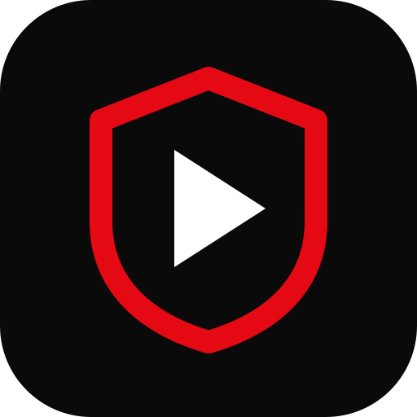

<p align="center">
  
</p>

<h1 align="center">StreamVault</h1>

<p align="center"><strong>Your library. Your server. Your screen.</strong><br>
A self-hosted home for movies, series and live TV — with private node-to-node sharing.</p>

<p align="center">
  <a href="https://github.com/sPROFFEs/StreamVault/actions/workflows/build.yml"></a>
  <a href="https://github.com/sPROFFEs/StreamVault/releases"></a>
  <a href="docs/SETUP.md"></a>
  <a href="docs/FEDERATION.md"></a>
</p>

<p align="center">
  <a href="docs/SETUP.md"><strong>Get started</strong></a> ·
  <a href="https://github.com/sPROFFEs/StreamVault/releases">Android APK & releases</a> ·
  <a href="docs/FEDERATION.md">Connect your nodes</a> ·
  <a href="https://github.com/sPROFFEs/StreamVault/issues">Report a bug</a>
</p>

## One library, wherever you watch

StreamVault brings a cinematic interface to your own media server. Discover a
movie, pick an episode, choose a local or federated source, and continue watching
from your account. Desktop, mobile and TV browsers share the same web interface;
the lightweight Android app connects to your server without a second backend.

- **Movies & series:** search, metadata and artwork with TMDB, favorites, seasons,
  episodes and saved playback progress.
- **Playback that stays yours:** fullscreen controls, keyboard/D-pad navigation,
  audio-track selection and subtitles; server-side conversion for supported formats.
- **Server-side downloads:** progress, speed and ETA, searchable movie/series
  organization, storage limits and administrator file management.
- **Private federation:** connect trusted StreamVault nodes and stream completed
  media without copying the entire library. Browse local and remote files together
  and filter by server.
- **Offline on your device:** explicitly save a local/node movie or episode,
  manage a device storage budget and watch without a server connection.
  [Limits and privacy](docs/OFFLINE.md).
- **Live TV:** IPTV playlists and channel browsing alongside your media library.
- **Multi-user by design:** per-user preferences, English/Spanish UI, optional
  community profiles and separately controlled aggregate viewing metrics.
- **Built-in operations:** service monitoring, backups, update checks and
  administrator-managed maintenance. Cloudflare Tunnel is an optional integration.

This is an actively developed self-hosted project. Provider availability, browser
codecs and device support vary; see the guides before choosing a deployment.

## Get running

On **Debian or Ubuntu**, install Git, then:

```sh
git clone https://github.com/sPROFFEs/StreamVault.git
cd StreamVault
sudo bash vault/setup.sh --non-interactive --domain localhost
```

The installer prepares Docker/Compose, persistent storage and your first
administrator. Open **http://localhost** and save the generated administrator
password. For other devices, configure a reachable **HTTPS** origin with a trusted
certificate. Review the installer before running it with administrator privileges.

Already have Docker, or upgrading an existing deployment? Follow the
[manual installation guide](docs/SETUP.md#initial-installation) or
[existing deployment upgrade guide](docs/RELEASES.md#updating-an-existing-deployment).
Keep your existing data directory and `SECRET_KEY` when upgrading.

## Android: your server, in your pocket

Get `streamvault-VERSION-android.apk` from [Releases](https://github.com/sPROFFEs/StreamVault/releases),
verify it with the accompanying `SHA256SUMS`, and enter your server's HTTPS address
on first launch. Android **8.0+** and an up-to-date Android System WebView are required.
The APK installs StreamVault's interface and offline player locally, with Android
integration for fullscreen, playback screen wake and verified in-app APK updates.
It is a packaged WebView client, not a bundled server or preloaded media library.
After the first connected setup, **Save to device** makes selected videos available
in its offline library; downloads must finish with the screen open.
Selected subtitle languages are downloaded alongside the video when available.
**More → About & updates** shows versions, release notes and Android downloads.

Stable version tags build and publish the signed APK, server archive and checksums
after the web, Android and security checks pass. APK downloads appear once the
first signed release has been published. See [Android setup](android/README.md)
and [release/signing instructions](docs/RELEASES.md#repository-configuration).

## Share a library, not your credentials

On the publishing node, enable federation and issue a scoped credential. On the
receiving node, add the trusted server and synchronize its catalog. Completed
movies and episodes then appear as **Node · Server name** sources and in Downloads.
Keep sharing one-way or connect both directions; each administrator controls access.

Profiles are private by default. Media sharing, profile visibility and aggregate
metrics are independent choices. Read the [federation guide](docs/FEDERATION.md)
for setup, permissions and bandwidth considerations.

## Simple stack, no frontend build chain

**Python 3.11 · FastAPI · Jinja · Vanilla JavaScript/CSS · SQLite · Docker Compose**

The server renders the interface directly: no Node frontend build or static-site
hosting is required. Compose separates the application, downloader/media tools,
nginx and optional tunnel. Android uses a small Java WebView client.

## Help shape StreamVault

Bug reports, UI feedback, documentation and focused pull requests are welcome.
For playback problems, include the browser/device, relevant codec information,
app version and redacted logs — never API keys, session cookies or tunnel tokens.
Start with [development and test setup](docs/SETUP.md#build-and-test).

If StreamVault is useful to you, **give the repository a star** to help other
self-hosters discover it.

## Documentation

- [Installation, devices and everyday use](docs/SETUP.md)
- [Android builds and device checks](android/README.md)
- [Federation and community privacy](docs/FEDERATION.md)
- [Device downloads and offline viewing](docs/OFFLINE.md)
- [Releases, signing, backups and updates](docs/RELEASES.md)
- [Deployment services and configuration](vault/README.md)
- [Regression and browser tests](vault/core/tests/README.md)

StreamVault includes no media, accounts or provider credentials. Only access and
share content you have the right to use. TMDB, subtitles, IPTV and other external
integrations may require separate configuration and remain subject to their own terms.
